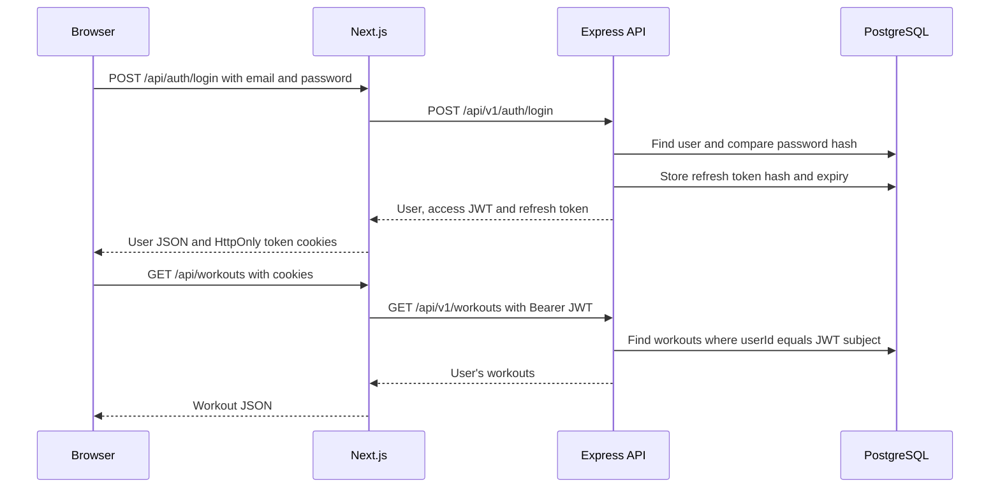

# Authentication in the current source

This is a source-based explanation of `main` at commit `3110e05f2a578c1462910142f4efed1cf6adf1cc`. It describes the code reviewed, rather than claiming to verify the live deployment. The catalogue addition does not change authentication.

## Components

| Component | Responsibility | Source |
| --- | --- | --- |
| Web login/register form | Collects credentials and sends JSON to same-origin Next.js handlers | [auth-form.tsx](../apps/web/src/components/auth-form.tsx) |
| Next.js route handlers | Forward login/registration to Express, return user data, and set token cookies | [login](../apps/web/src/app/api/auth/login/route.ts), [register](../apps/web/src/app/api/auth/register/route.ts) |
| Server-side API adapter | Uses server-only `API_URL`, adds JSON headers, disables fetch caching | [api-server.ts](../apps/web/src/lib/api-server.ts) |
| Web renewal helper | Sends Bearer access tokens upstream; on 401, refreshes and retries once | [api-auth.ts](../apps/web/src/lib/api-auth.ts) |
| Express API | Validates input, hashes/checks passwords, creates/rotates/revokes sessions, enforces access to user data | [app.ts](../apps/api/src/app.ts) |
| Token helpers | Signs/verifies JWTs, generates random refresh tokens, computes token hashes | [auth.ts](../apps/api/src/auth.ts) |
| PostgreSQL through Prisma | Stores users, password hashes, session hashes and expiry/revocation timestamps | [schema.prisma](../apps/api/prisma/schema.prisma) |
| Mobile client | Logs in directly, stores tokens in Expo SecureStore, adds Bearer headers and retries after refresh | [login.tsx](../apps/mobile/app/(auth)/login.tsx), [auth.ts](../apps/mobile/src/lib/auth.ts), [api.ts](../apps/mobile/src/lib/api.ts) |

There is no OAuth, NextAuth, Clerk or third-party identity provider in this implementation.

## Web request flow



Registration follows the same path through `/api/auth/register` and `/api/v1/auth/register`. Zod lowercases the email, requires an 8–128 character password, and checks a 2–80 character trimmed name. Duplicate emails return 409. The server sets the default role from the database (`ATHLETE`); the client cannot select an administrator role through this endpoint.

Login returns 401 for an unknown user or incorrect password. The API returns explicitly selected user fields, not `passwordHash`. The web handler removes both token strings from its JSON response and sets cookies instead. The form navigates to `/dashboard` after success.

The protected API endpoints currently implemented are `GET /api/v1/auth/me` and `GET /api/v1/workouts`. Both require `Authorization: Bearer <JWT>` and call `verifyAccess`. `/me` reloads the user; `/workouts` filters by the JWT `sub`. The web adapters are `/api/auth/session` and `/api/workouts`.

## Credential and token handling

| Value | Created / checked | Storage and lifetime |
| --- | --- | --- |
| Password | `bcrypt.hash(password, 12)` at registration; `bcrypt.compare` at login | Only `User.passwordHash` is persisted by the active API. Credentials travel in JSON request bodies. HTTPS is a deployment requirement. |
| Access token | `jose.SignJWT`, HS256, signed with `JWT_SECRET`; contains `sub`, `email`, `role`, `iat`, `exp` | Valid 15 minutes. Web: `muscupro_access` cookie with `maxAge: 900`. Mobile: SecureStore key `muscupro.accessToken`. No access-token database row. |
| Refresh token | `randomBytes(48).toString("base64url")`, then SHA-256 for database lookup | Database: unique `Session.tokenHash`, `userId`, `expiresAt`, optional `revokedAt`. Each successor expires in 30 days. Web: `muscupro_refresh` cookie with `maxAge: 2592000`. Mobile: SecureStore key `muscupro.refreshToken`. |
| JWT signing key | `JWT_SECRET` parsed at startup with a minimum length of 32 | API environment only; never returned by the auth endpoints. The length check does not establish randomness. |

The token creation code, formatted for readability from [auth.ts](../apps/api/src/auth.ts), is:

```ts
new SignJWT({ email: user.email, role: user.role })
  .setProtectedHeader({ alg: "HS256" })
  .setSubject(user.sub)
  .setIssuedAt()
  .setExpirationTime("15m")
  .sign(key);
```

JWTs are signed, not encrypted: their identity claims should not be treated as secret. `jwtVerify(token, key)` performs verification; the application does not configure issuer/audience requirements or perform a separate runtime schema check of the returned identity.

Both browser cookies use `HttpOnly`, `SameSite=Lax`, `Path=/`, and `Secure` when `NODE_ENV=production`. Browser JavaScript does not read these cookies. Next.js reads them server-side and supplies the Bearer header to Express. Express itself returns tokens in JSON; it does not set browser cookies. No active browser localStorage token handling exists. The exercise catalogue's localStorage stores exercise IDs for favorites only.

## Renewal and logout

1. On a 401 (or absent web access cookie), the client obtains its refresh token and posts `{refreshToken}` to `/api/v1/auth/refresh`.
2. Express hashes it and loads the session plus user. Missing, revoked or expired sessions return 401.
3. A database transaction revokes the old row and creates a new session with a fresh token hash and another 30-day expiry.
4. The API returns a fresh 15-minute JWT and new refresh token. Next.js replaces both cookies; mobile saves both in SecureStore. The original request is retried once.
5. Mobile clears its stored tokens if the refresh response is unsuccessful. The web helper leaves expired/invalid cookies in place on failure; there is no automatic page redirect in that helper.

`POST /api/auth/logout` forwards the web refresh token to Express, then clears both cookies. Express marks the matching refresh session revoked and responds 204. If the upstream logout fails, the web handler still clears the browser cookies. Access JWTs are not checked against the session table, so a previously copied JWT can remain usable until its 15-minute expiry. The mobile source has a `clearTokens` helper but no logout screen wired to the revocation endpoint.

## Docs and implementation boundaries

- The README previously linked to this authentication document, but it was absent in the reviewed tree. It also described email verification, password reset and profile security flows that are not implemented by the current API. Their web pages are placeholders; `emailVerifiedAt` exists in the schema but login does not require it.
- [Deployment docs](DEPLOY_RAILWAY_VERCEL.md) configure `DATABASE_URL`, `JWT_SECRET`, `WEB_ORIGIN` and production mode for the API; `API_URL` and `AUTH_SECRET` for the web app. `AUTH_SECRET` is referenced only by the unused HMAC session helper in [session.ts](../apps/web/src/lib/session.ts). Its 12-hour token is not the JWT used by active routes. [demo-users.ts](../apps/web/src/lib/demo-users.ts) is also unused by active routes; its in-memory plaintext demo records are not the Prisma authentication store. The form still pre-fills sample credentials, with no database seeding shown.
- The production example also contains `NEXT_PUBLIC_API_URL`, which the active web adapter does not read. Mobile reads `expoConfig.extra.apiUrl` and defaults to localhost; the checked-in Expo config does not set it.
- Roles are stored and included in JWTs, but the current API has no role-based administrator/coach checks. Dashboard/admin pages have no session guard, the workouts UI displays static examples, and `PremiumGuard` simply renders its children. API data protection and page protection are separate concerns here.
- [security.ts](../apps/api/src/security.ts) applies security headers and a process-local limit of 20 requests per IP per 15 minutes to **all** `/api/v1/auth` routes, including `/me` and refresh. CORS allows the configured `WEB_ORIGIN` with credentials; there is no explicit CSRF token or Origin check in the Next.js handlers. Inference: because the web adapter does not forward the browser IP, proxied users may share the API's observed IP limit.
- Rotation checks occur before the transaction, without an atomic conditional update. Inference: simultaneous refresh calls can both pass the initial check and create successors. There is no client refresh lock or session-family reuse revocation in the reviewed code.
- [auth.test.ts](../apps/api/src/auth.test.ts) contains two token-helper tests. It does not cover registration/login over HTTP, database rotation races, cookie flags or logout end to end. This review traces source; it does not claim those flows were exercised against a live API.

Secrets should remain in environment configuration. [.gitignore](../.gitignore) excludes `.env` files and preserves the example template; the README explicitly says not to commit secrets.
